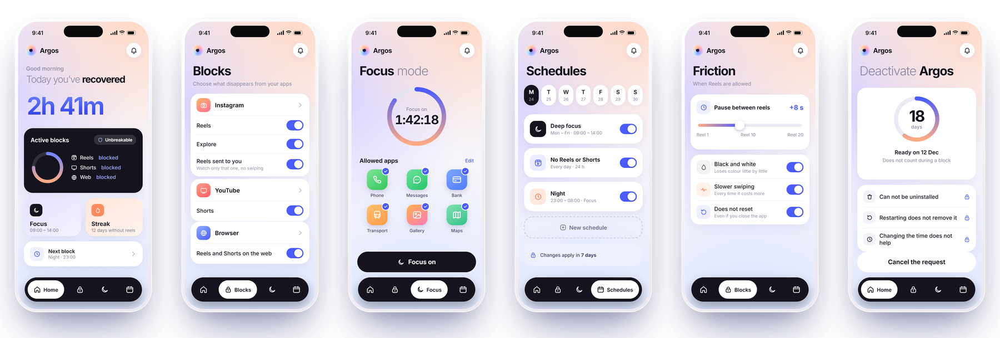
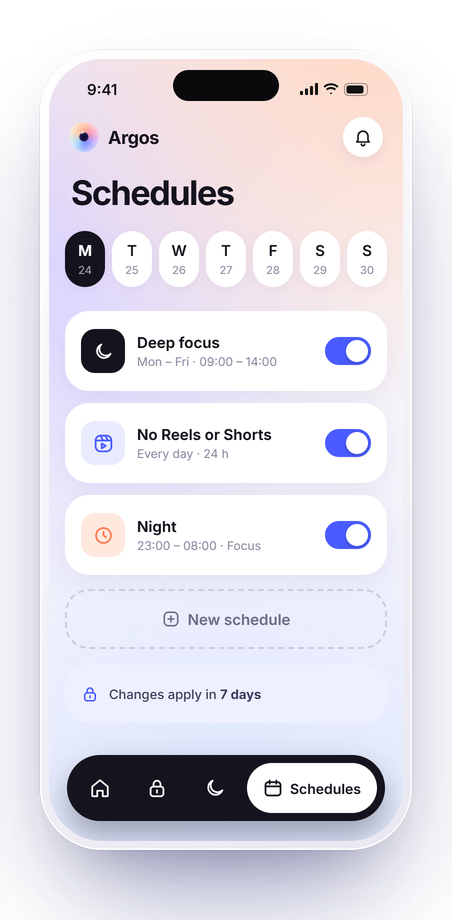
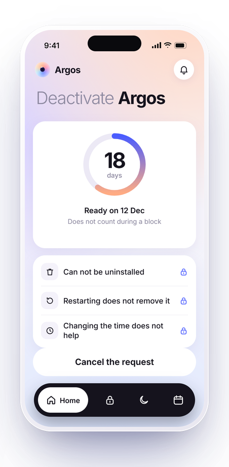

<p align="center">
  
</p>

<h1 align="center">Argos</h1>

<p align="center">
  <b>Take back your attention.</b><br>
  An Android app that switches off Reels and Shorts, with a lock you can not undo on a whim.
</p>

<p align="center">
  
  
  
  
  
</p>

<p align="center">
  <a href="https://github.com/iago-df/argos/releases/latest/download/Argos.apk"><b>⬇ Download for Android</b></a>
  &nbsp;·&nbsp;
  <a href="https://iago-df.github.io/argos/">▶ Watch the promo video</a>
</p>

<p align="center">
  <a href="https://iago-df.github.io/argos/"></a><br>
  <sub>▶ <a href="https://iago-df.github.io/argos/">Watch the full promo video (82 s, with sound)</a></sub>
</p>

<p align="center">
  
</p>

> [!NOTE]
> The video and the screens on this page use sample data. The app comes in English (default) and Spanish; switch it in settings.

## Why

You open Instagram to answer a message. Forty minutes later you are still swiping.

Blockers do not fix that, because the same person who set the blocker can switch it off in two taps. Argos is built the other way round:

- **Stricter, right away.** Turning a block on or tightening a schedule applies at once.
- **Softer, after 7 days.** Turning a block off, removing an allowed app or shortening a schedule waits a week.
- **Off, after 30 days.** Switching Argos off is a request that takes 30 days, and those days do not count while a block is running.

Set up as device owner, Argos can not be uninstalled, the phone can not boot into safe mode and the time can not be changed. The only quick way out is a factory reset, and that is on purpose.

## Features

<table>
  <tr>
    <td width="33%"></td>
    <td width="33%"></td>
    <td width="33%"></td>
  </tr>
  <tr>
    <td valign="top">
      <h3>Home</h3>
      The time you recovered today, what is blocked right now, your streak of days without reels and the next block coming up. The bell shows everything Argos stopped today.
    </td>
    <td valign="top">
      <h3>Blocks</h3>
      Instagram Reels and Explore, YouTube Shorts, and Reels, Shorts and TikTok in the browser. Argos puts a lock over the Reels and Shorts tabs, so you never get in. The rest of each app keeps working: messages, stories, search, normal videos.
      <br><br>
      <b>Explore</b>: the grid is covered, so no reel opens and none plays with a long press. Search still works.
      <br><br>
      <b>Reels sent to you</b>: a reel opened from a chat plays, but you can not swipe to the next one or pull down for a new one.
    </td>
    <td valign="top">
      <h3>Focus mode</h3>
      Pick the apps you really need (bank, calls, transport, maps) and start a focus. Any other app is sent back to the home screen until the countdown ends. Calls and settings always work.
    </td>
  </tr>
  <tr>
    <td></td>
    <td></td>
    <td></td>
  </tr>
  <tr>
    <td valign="top">
      <h3>Schedules</h3>
      Rules that switch on by themselves: Focus on weekday mornings, no Reels or Shorts all day, Focus at night. Overnight rules work too.
    </td>
    <td valign="top">
      <h3>Friction</h3>
      For the times reels are allowed. Every reel adds a longer pause before the next one, the screen slowly loses its colour and swiping takes longer. The count does not reset when you close the app.
    </td>
    <td valign="top">
      <h3>Deactivate</h3>
      Request it and a 30 day countdown starts. It stops moving while a block is running, and you can cancel it at any time. When it ends, Argos lets go and can be uninstalled.
    </td>
  </tr>
</table>

## How the lock works

| You want to… | What happens once Argos is locked (with the [unbreakable setup](#unbreakable-mode)) |
| --- | --- |
| Turn a block on, add a schedule, make one longer | Applies right away |
| Turn a block off, shorten or delete a schedule, allow more apps, lower the friction | Waits 7 days, then applies by itself |
| End a focus early | Not possible |
| Switch Argos off | Request it: 30 days that do not count during blocks |
| Uninstall it, force stop it, clear its data | Blocked (device owner) |
| Restart the phone | Argos comes back on its own |
| Boot into safe mode, change the time | Blocked (device owner) |
| Turn its accessibility service off | It is turned back on at once |
| Factory reset | Works. It is the emergency exit |

Before you lock it, everything applies at once, so you can set it up calmly.

## Install on Android

No building needed. Android 9 or newer.

1. On your phone, download **[Argos.apk](https://github.com/iago-df/argos/releases/latest/download/Argos.apk)** (it is also on the [Releases](https://github.com/iago-df/argos/releases) page).
2. Open the file. If Android asks, allow your browser or file manager to **install unknown apps**. If Play Protect says the app is not recognised, tap **More details → Install anyway**.
3. Open Argos and tap **Finish setting up Argos** on the Home screen:
   - **Accessibility service**: turn Argos on. On Android 13 and newer, if the switch is greyed out, open Argos in *Settings → Apps*, tap the ⋮ menu and choose **Allow restricted settings** first.
   - **Usage access**: for the time recovered.
   - **Notifications**: a quiet notification keeps Argos awake.

That is enough for every block, Focus, schedules and friction. For the lock that can not be undone, keep going.

Each release lists the SHA-256 of the APK and of the signing certificate, so you can check the file is the original.

## Unbreakable mode

Android only lets an app become **device owner** from a computer, and only while the phone has no accounts on it.

1. On the phone, remove your accounts in *Settings → Accounts* (Google, WhatsApp backup, etc.). You can add them back right after.
2. Turn on **USB debugging** (*Settings → About phone →* tap *Build number* 7 times, then *System → Developer options*).
3. Connect the phone and run:

```bash
adb shell dpm set-device-owner com.iagodf.argos/.lock.ArgosAdmin
```

```bash
adb shell pm grant com.iagodf.argos android.permission.WRITE_SECURE_SETTINGS
```

The first command lets Argos block uninstalling, safe mode, changing the time and force stopping apps. The second lets it switch its own accessibility service back on and use Android's real black and white mode for friction.

4. Add your accounts back.
5. In Argos, tap the **Active blocks** card on Home and then **Lock Argos**.

> [!WARNING]
> Once locked, Argos also turns off USB debugging, so the commands above can not be used to undo it. The only ways out are the 30 day deactivation or a factory reset, which erases the phone. Lock it only if you mean it.

## What Argos can see

Argos uses Android's accessibility service to know what is on screen. It only reads Instagram, YouTube, the usual browsers and the system settings, and only to find the reels tab, the Shorts player, the address bar or a settings page that could switch it off. During Focus it also looks at which app is opening, and nothing else about it.

On a reel sent in a chat, Argos holds your swipes up and down and hands every other touch (taps, likes, sideways swipes) back to Instagram as it was. It never touches anything on its own.

The app does not ask for the internet permission. It has no account, no analytics and no server: everything stays on your phone, in the app's own storage.

## Build from source

You need Android Studio, or the Android SDK with JDK 17 or newer.

```bash
git clone https://github.com/iago-df/argos.git
```

```bash
cd argos && ./gradlew assembleDebug
```

The APK is written to `app/build/outputs/apk/debug/`.

### Project structure

| Path | What is there |
| --- | --- |
| [`data/`](app/src/main/java/com/iagodf/argos/data) | The store (blocks, schedules, focus, friction, the 7 and 30 day waits), the policy that mixes them, usage stats and the app language |
| [`engine/`](app/src/main/java/com/iagodf/argos/engine) | The accessibility service: reads the screen, gets you out, draws the toasts and the friction pause |
| [`lock/`](app/src/main/java/com/iagodf/argos/lock) | Device owner policies and the guard service that keeps Argos alive after a reboot |
| [`ui/`](app/src/main/java/com/iagodf/argos/ui) | The screens from the promo video, in Jetpack Compose |

## Limitations

- Instagram and YouTube rename their screens from time to time. When they do, a block may stop working until the ids in [`Screen.kt`](app/src/main/java/com/iagodf/argos/engine/Screen.kt) are updated. If a reel opens some other way (a link, a reel in the feed), Argos still takes you out of it.
- The browser block reads the address bar of Chrome, Firefox, Brave, Edge, Samsung Internet, Opera, DuckDuckGo, Kiwi and Vivaldi.
- Without the `WRITE_SECURE_SETTINGS` command, friction uses a grey veil instead of real black and white.

## License

[MIT](LICENSE)
