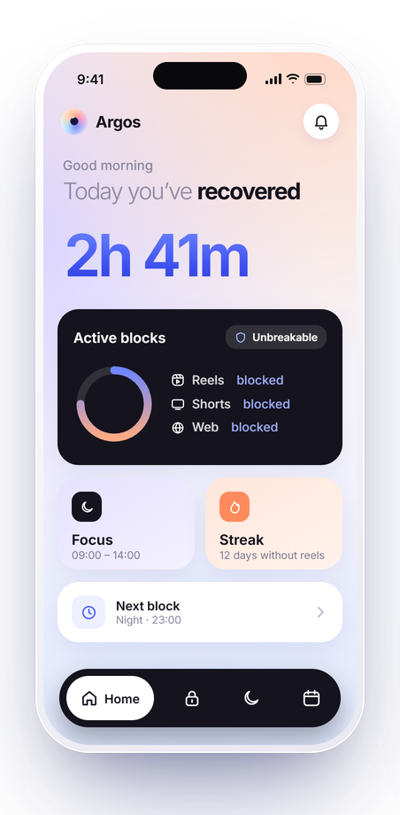
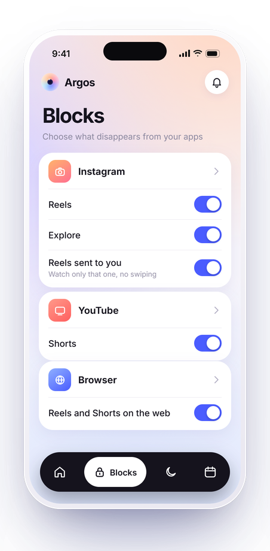
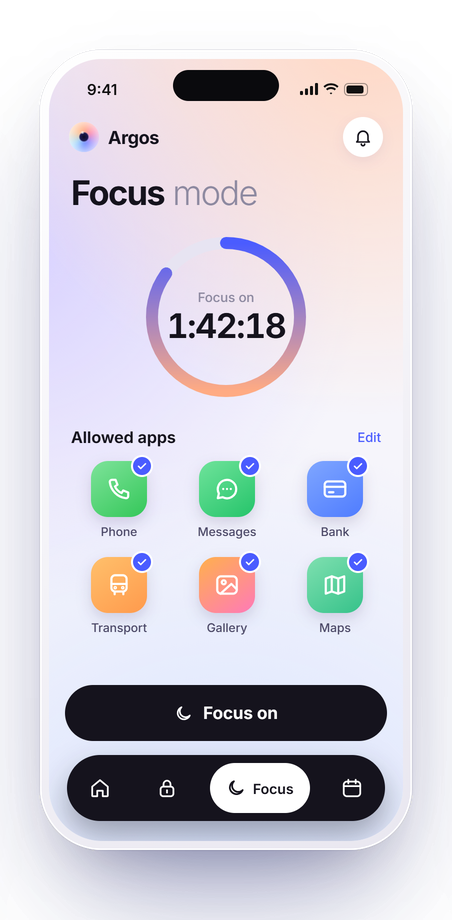
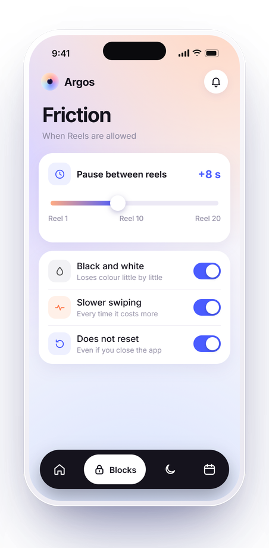

<p align="center">
  
</p>

<h1 align="center">Argos</h1>

<p align="center">
  <b>Take back your attention.</b><br>
  An Android app that switches off Reels and Shorts, with a lock you can not undo on a whim.
</p>

<p align="center">
  
  
  
  
  
</p>

<p align="center">
  <a href="https://github.com/iago-df/argos/releases/latest/download/Argos.apk"><b>⬇ Download for Android</b></a>
  &nbsp;·&nbsp;
  <a href="https://iago-df.github.io/argos/">▶ Watch the promo video</a>
</p>

<p align="center">
  <a href="https://iago-df.github.io/argos/"></a><br>
  <sub>▶ <a href="https://iago-df.github.io/argos/">Watch the full promo video (82 s, with sound)</a></sub>
</p>

<p align="center">
  
</p>

> [!NOTE]
> The video and the screens on this page use sample data. The app comes in English (default) and Spanish; switch it in settings.

## Why

You open Instagram to answer a message. Forty minutes later you are still swiping.

Blockers do not fix that, because the same person who set the blocker can switch it off in two taps. Argos is built the other way round:

- **Stricter, right away.** Turning a block on or tightening a schedule applies at once.
- **Softer, after 7 days.** Turning a block off, removing an allowed app or shortening a schedule waits a week.
- **Off, after 30 days.** Switching Argos off is a request that takes 30 days, and those days do not count while a block is running.

Set up as device owner, Argos can not be uninstalled, the phone can not boot into safe mode and the time can not be changed. The only quick way out is a factory reset, and that is on purpose.

## Features

Four tabs: **Home**, **Blocks** (what is blocked), **Focus** (when: now or on a schedule) and **Lock** (the optional lock that can not be undone on a whim).

<table>
  <tr>
    <td width="33%"></td>
    <td width="33%"></td>
    <td width="33%"></td>
  </tr>
  <tr>
    <td valign="top">
      <h3>Home</h3>
      The time you recovered today, what is blocked right now, your streak of days without reels and the next block coming up. The bell shows everything Argos stopped today.
    </td>
    <td valign="top">
      <h3>Blocks</h3>
      Instagram Reels and Explore, YouTube Shorts, and Reels, Shorts and TikTok in the browser. Tapping the Reels or Shorts tab shows the blocked pill and keeps you on the tab you were on. Nothing is drawn on top of the apps. The rest of each app keeps working: messages, stories, search, normal videos.
      <br><br>
      <b>Explore</b>: open for searching. A long press on a reel does not play it, and a reel you open is closed.
      <br><br>
      <b>Reels sent to you</b>: a reel opened from a chat plays. Swipe to the next one and you are back on the one you were sent.
      <br><br>
      <b>Sites and words</b>: in any browser, if the address, the search or what you type contains one of them (<code>youtube</code>, <code>tiktok</code>…), you are taken out.
    </td>
    <td valign="top">
      <h3>Focus</h3>
      Pick the apps you really need (bank, calls, transport, maps) and start a focus. Any other app is sent back to the home screen until the countdown ends. Calls and settings always work. The schedules live in this tab too.
    </td>
  </tr>
  <tr>
    <td></td>
    <td></td>
    <td></td>
  </tr>
  <tr>
    <td valign="top">
      <h3>Schedules</h3>
      At the bottom of the Focus tab. A focus that switches on by itself (weekday mornings, nights), or Reels and Shorts gone only at some hours. Overnight rules work too.
    </td>
    <td valign="top">
      <h3>Friction</h3>
      For the times reels are allowed. Every reel you have to stay a bit longer before the next one lets you through, and every 5 reels it takes one more swipe. Too early and you are back on the reel you were on: no pop ups. The screen can also lose its colour little by little.
    </td>
    <td valign="top">
      <h3>Deactivate</h3>
      Request it and a 30 day countdown starts. It stops moving while a block is running, and you can cancel it at any time. When it ends, Argos lets go and can be uninstalled.
    </td>
  </tr>
</table>

## How the lock works

The **Lock** tab is where you get the lock ready. Nothing in it does anything until you turn it on, and turning it on takes two confirmations, the last one a 3 second press.

What the lock adds while it is on:

- **Paused apps.** The apps you pick are greyed out and do not open. Phone, messages, contacts, camera, gallery, email and clock can never be paused.
- Your blocks, sites and words, Focus, schedules and friction stay as you set them, protected: only stricter right away.

| You want to… | What happens once Argos is locked (with the [unbreakable setup](#unbreakable-mode)) |
| --- | --- |
| Turn a block on, add a schedule, pause one more app, add a word | Applies right away |
| Turn a block off, shorten or delete a schedule, allow more apps, lower the friction, unpause an app, remove a word | Waits 7 days, then applies by itself |
| End a focus early | Not possible |
| Switch Argos off | Request it: 30 days that do not count during blocks |
| Uninstall Argos, force stop it, clear its data | Blocked (device owner) |
| Uninstall, clear or force stop any other app | Works as always |
| Restart the phone | Argos comes back on its own |
| Boot into safe mode, change the time | Blocked (device owner) |
| Turn its accessibility service off | It is turned back on at once |
| Update Argos | Install the new APK over it. The commands are not needed again |
| Factory reset | Works. It is the emergency exit |

Before you lock it, everything applies at once, so you can set it up calmly.

> [!NOTE]
> The current releases are test builds: the Lock tab also has **Switch off now (testing)**, so the lock can be lifted right away while Argos is being tuned. It will go in a later release, leaving only the 30 day request.

## Install on Android

No building needed. Android 9 or newer.

1. On your phone, download **[Argos.apk](https://github.com/iago-df/argos/releases/latest/download/Argos.apk)** (it is also on the [Releases](https://github.com/iago-df/argos/releases) page).
2. Open the file. If Android asks, allow your browser or file manager to **install unknown apps**. If Play Protect says the app is not recognised, tap **More details → Install anyway**.
3. Open Argos and tap **Finish setting up Argos** on the Home screen:
   - **Accessibility service**: turn Argos on. On Android 13 and newer, if the switch is greyed out, open Argos in *Settings → Apps*, tap the ⋮ menu and choose **Allow restricted settings** first.
   - **Usage access**: for the time recovered.
   - **Notifications**: a quiet notification keeps Argos awake.

That is enough for every block, Focus, schedules and friction. For the lock that can not be undone, see [Unbreakable mode](#unbreakable-mode).

Each release lists the SHA-256 of the APK and of the signing certificate, so you can check the file is the original.

## Unbreakable mode

Optional. It makes Argos **device owner**, so once locked it can not be uninstalled or switched off. It is done once, changes nothing until you turn the lock on, and updating Argos does not need it again. Android only allows it while the phone has no accounts on it, so in both ways you remove them for a few minutes and add them back after.

### Without a computer: Argos Setup

Android 11 or newer, on Wi-Fi (no internet needed, only the network; do it on your home Wi-Fi).

1. In Argos, open the **Lock** tab and tap **Do it without a computer**. Android asks to let Argos install apps the first time, then to install **Argos Setup**, a small helper that comes inside `Argos.apk`.
2. Argos Setup walks you through it: remove your accounts, turn on developer options (tap *Build number* 7 times) and **Wireless debugging**, then tap **Pair device with pairing code**.
3. Pull the notifications down and type the 6 digit code in the Argos Setup one.
4. It pairs with the phone itself, runs the two commands, switches wireless debugging off, removes itself and opens Argos. If an account is left, it says which one and you tap **Retry**.
5. Add your accounts back.

### With a computer and a cable

Works on any Android and does not use the Wi-Fi at all.

1. On the phone, remove **every** account in *Settings → Accounts* (Google, Outlook, Samsung, WhatsApp…), and any work profile, secure folder or second space. Keep their passwords at hand. If one is left, the first command fails and nothing changes: remove it and run it again (`adb shell dumpsys account` lists them).
2. On the computer, download **[SDK Platform-Tools](https://developer.android.com/tools/releases/platform-tools)** and unzip it. That is where `adb` lives.
3. On the phone, turn on **USB debugging**: *Settings → About phone →* tap *Build number* 7 times, then *Developer options → USB debugging*.
4. Plug the phone in with a data cable and accept **Allow USB debugging?** on the phone. In a terminal inside the Platform-Tools folder, check that it is seen:

```bash
adb devices
```

5. Run the two commands:

```bash
adb shell dpm set-device-owner com.iagodf.argos/.lock.ArgosAdmin
```

```bash
adb shell pm grant com.iagodf.argos android.permission.WRITE_SECURE_SETTINGS
```

The first one answers `Success: Device owner set to package com.iagodf.argos` and makes Argos device owner. The second one prints nothing and lets Argos switch its own accessibility service back on and use Android's real black and white mode for friction.

6. Unplug the phone and add your accounts back.

### Then

Set up the **Lock** tab and turn the lock on when you are sure. Until then, **Drop unbreakable mode** in the Lock tab gives up device owner right away, so Argos can be uninstalled like any app.

> [!WARNING]
> Once locked, Argos also turns off USB debugging, so the commands above can not be used to undo it. The only ways out are the 30 day deactivation or a factory reset, which erases the phone. Lock it only if you mean it.

## What Argos can see

Argos uses Android's accessibility service to know what is on screen. It only reads Instagram, YouTube, the usual browsers and the system settings, and only to find the reels tab, the Shorts player, the address bar or a settings page that could switch it off. During Focus it also looks at which app is opening, and nothing else about it.

Argos never draws anything on top of Instagram or YouTube except the small blocked pill. To undo a swipe it scrolls the reels back by one, the same way a screen reader would.

Argos does not ask for the internet permission. It has no account, no analytics and no server: everything stays on your phone, in the app's own storage.

**Argos Setup** is the only part with the internet permission, because Android asks for it to open any connection, even to the phone itself. It only connects to the phone's own wireless debugging, only while you use it, and then it removes itself together with its pairing key. Argos asks to install apps only to install it, and only when you tap the button.

## Build from source

You need Android Studio, or the Android SDK with JDK 17 or newer.

```bash
git clone https://github.com/iago-df/argos.git
```

```bash
cd argos && ./gradlew assembleDebug
```

The APK is written to `app/build/outputs/apk/debug/`.

### Project structure

| Path | What is there |
| --- | --- |
| [`data/`](app/src/main/java/com/iagodf/argos/data) | The store (blocks, schedules, focus, friction, the 7 and 30 day waits), the policy that mixes them, usage stats and the app language |
| [`engine/`](app/src/main/java/com/iagodf/argos/engine) | The accessibility service: reads the screen, gets you out, draws the toasts and the friction pause |
| [`lock/`](app/src/main/java/com/iagodf/argos/lock) | Device owner policies and the guard service that keeps Argos alive after a reboot |
| [`ui/`](app/src/main/java/com/iagodf/argos/ui) | The screens from the promo video, in Jetpack Compose |
| [`setup/`](setup/src/main/java/com/iagodf/argos/setup) | Argos Setup: pairs with wireless debugging and runs the two commands. Built and packed inside `Argos.apk` |

## Limitations

- Instagram and YouTube rename their screens from time to time. When they do, a block may stop working until the ids in [`Screen.kt`](app/src/main/java/com/iagodf/argos/engine/Screen.kt) are updated. If a reel opens some other way (a link, a reel in the feed), Argos still takes you out of it.
- The browser block reads the address bar of Chrome, Firefox, Brave, Edge, Samsung Internet, Opera, DuckDuckGo, Kiwi and Vivaldi.
- Without the `WRITE_SECURE_SETTINGS` command, friction uses a grey veil instead of real black and white.
- Argos Setup needs Android 11 or newer and a Wi-Fi network. Older phones use the cable.
- Argos Setup uses [libadb-android](https://github.com/MuntashirAkon/libadb-android) (Apache 2.0) and Conscrypt for the pairing.

## License

[MIT](LICENSE)
